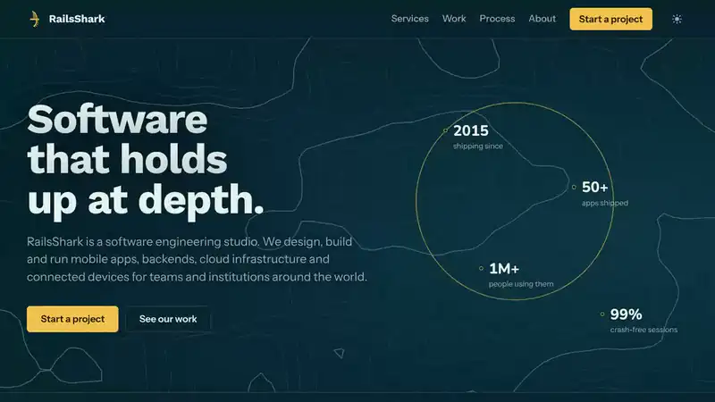
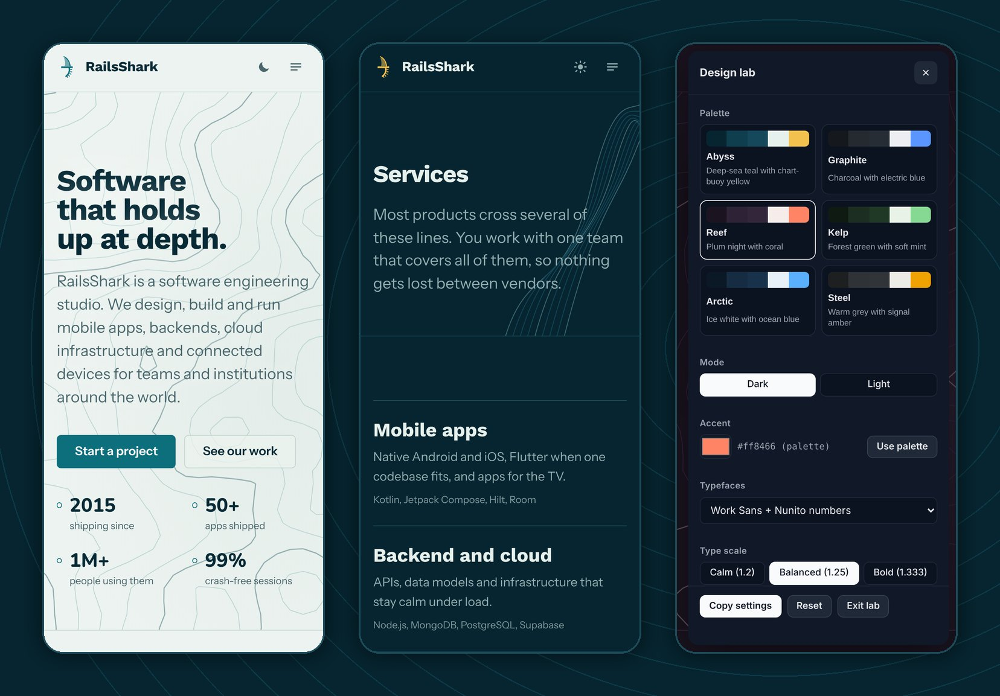
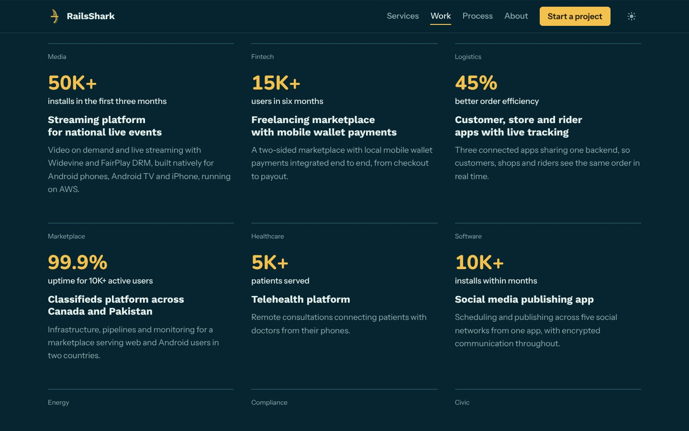
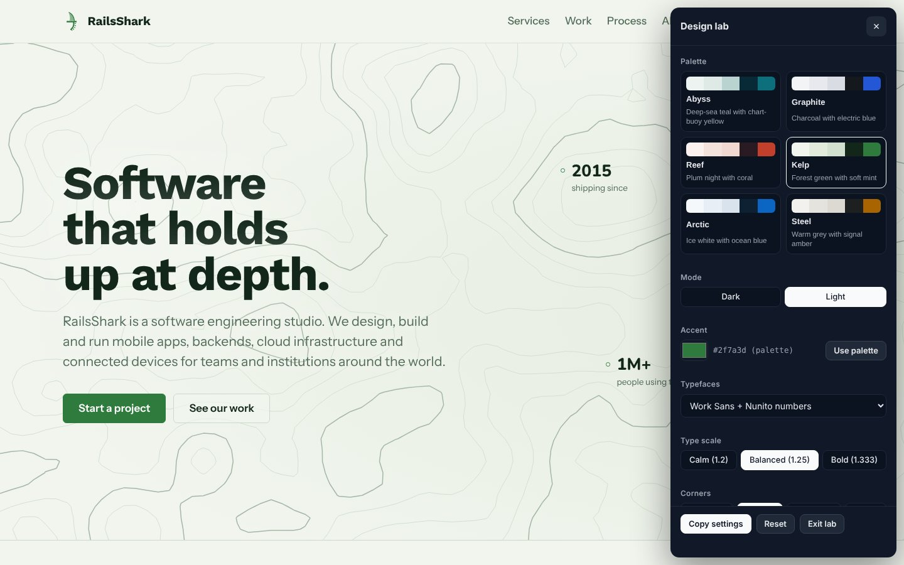

<div align="center">


# RailsShark

**Software that holds up at depth.**

A software engineering studio. We design, build and run mobile apps, backends, cloud infrastructure<br />
and connected devices for teams and institutions around the world, since 2015.

[**Visit the site**](https://railsshark.github.io/RailsShark/) &nbsp;&middot;&nbsp;
[**Start a project**](https://railsshark.github.io/RailsShark/contact/) &nbsp;&middot;&nbsp;
[**WhatsApp**](https://wa.me/923325987829)

[](https://github.com/RailsShark/RailsShark/actions/workflows/static.yml)


<br />



<sub>The hero is a live depth chart. Move your cursor to nudge the seabed, click the water to send a sonar ping.</sub>

</div>

<br />

## What we build

One team across the whole stack, from the firmware on a device to the app in someone's hand and the cloud in between.

| | Service | What it covers |
| :-: | :-- | :-- |
| 📱 | [**Mobile apps**](https://railsshark.github.io/RailsShark/services/mobile/) | Native Android and iOS, Flutter when one codebase fits, and apps for the TV |
| ☁️ | [**Backend and cloud**](https://railsshark.github.io/RailsShark/services/backend-cloud/) | APIs, data models and infrastructure that stay calm under load |
| 🚀 | [**DevOps and release engineering**](https://railsshark.github.io/RailsShark/services/devops/) | Pipelines that turn a merged pull request into a safe release |
| 📡 | [**IoT and embedded**](https://railsshark.github.io/RailsShark/services/iot/) | Firmware, telemetry and the apps that talk to your hardware |
| 🛡️ | [**Security and hardening**](https://railsshark.github.io/RailsShark/services/security/) | Mobile app security reviews, hardening and incident response |
| 🧠 | [**AI integration**](https://railsshark.github.io/RailsShark/services/ai/) | Useful AI features with guardrails, in the cloud or on the device |
| 🎬 | [**Streaming and OTT**](https://railsshark.github.io/RailsShark/services/streaming/) | Video on demand and live streaming with DRM, from phone to TV |
| 🖥️ | [**Desktop and systems**](https://railsshark.github.io/RailsShark/services/desktop/) | Windows and cross-platform desktop tools, services and automation |

## Track record

Products our engineers have designed, built and shipped. Client names stay private; the results are real.

<table>
  <tr>
    <td align="center" width="33%"><h3>50K+</h3>installs in three months for a streaming platform with DRM</td>
    <td align="center" width="33%"><h3>15K+</h3>users in six months for a marketplace with mobile wallet payments</td>
    <td align="center" width="33%"><h3>45%</h3>better order efficiency across customer, store and rider apps</td>
  </tr>
  <tr>
    <td align="center"><h3>99.9%</h3>uptime for a classifieds platform across Canada and Pakistan</td>
    <td align="center"><h3>80%</h3>shorter release time after rebuilding a mobile CI/CD pipeline</td>
    <td align="center"><h3>1M+</h3>people using the 50+ apps we have shipped</td>
  </tr>
</table>

<p align="center"><a href="https://railsshark.github.io/RailsShark/work/"><b>See all the work</b></a></p>

<br />

## Inside this site

This repository is the site itself, and it is built the way we build for clients: small, fast, accessible and easy to hand over.



- **A depth chart, not a stock photo.** The hero draws contour lines with a marching-squares pass over animated noise on a canvas. It pauses when off screen or in a background tab, and stays still for anyone who prefers reduced motion.
- **Almost no JavaScript.** Every page is static HTML. Scripts load only where they do something, such as the chart, the menu, the theme switch and the contact form: under 10 KB gzipped in total.
- **A design lab built in.** Open any page with [`?lab=1`](https://railsshark.github.io/RailsShark/?lab=1) to try six palettes, dark and light modes, any accent colour, seven type pairings, type scale, corners, spacing and motion, live. The lab only downloads when it is opened.
- **Smooth by default.** Native cross-page view transitions and hover prefetching make navigation feel instant, with no client-side router.
- **Accessible.** Real headings and landmarks, visible keyboard focus, a skip link, and respect for system motion settings. Lighthouse scores it 100 for accessibility.
- **One codebase, two hosts.** The same build serves from a subpath on GitHub Pages and from the root on Cloudflare Pages.
- **Privacy you can read.** No cookies, no analytics, no trackers, and a [plain-language privacy policy](https://railsshark.github.io/RailsShark/privacy/) covering GDPR, US state laws and the Australian Privacy Act.

<table>
  <tr>
    <td width="50%"></td>
    <td width="50%"></td>
  </tr>
  <tr>
    <td align="center"><sub>Track record, dark mode</sub></td>
    <td align="center"><sub>The design lab, trying the Kelp palette in light mode</sub></td>
  </tr>
</table>

### Lighthouse

Measured with Lighthouse 12 on the mobile profile (throttled CPU and network).

| Performance | Accessibility | Best practices | SEO |
| :-: | :-: | :-: | :-: |
| **98** | **100** | **100** | **100** |

### Built with

[Astro](https://astro.build) for static pages, TypeScript, plain CSS custom properties for theming, a canvas for the hero, self-hosted Work Sans, Nunito and Instrument Sans fonts, and GitHub Actions for deployment.

## Repository map

```text
.
├── site/                     The website (Astro)
│   ├── src/
│   │   ├── pages/            Home, services, work, process, about, contact, privacy
│   │   ├── components/       Hero, navigation, service index, work list, call to action
│   │   ├── data/             Services, track record and process content
│   │   ├── scripts/          Contour chart and design lab
│   │   ├── styles/           Design tokens and global styles
│   │   └── config/site.ts    Contact details, links and switches
│   └── README.md             Developer guide
└── .github/workflows/        Build and deploy to GitHub Pages
```

## Run it locally

```bash
cd site
npm install
npm run dev
```

Then open http://localhost:4321. The [developer guide](site/README.md) covers configuration, the design lab and both deployment targets.

## Deployment

Every push to `main` builds `site/` and publishes it to [railsshark.github.io/RailsShark](https://railsshark.github.io/RailsShark/) through GitHub Actions. The same code also deploys to Cloudflare Pages at the domain root.

## Work with us

Tell us what you are building. A short message is enough to start, and the first call is free.

<div align="center">

[**railsshark@gmail.com**](mailto:railsshark@gmail.com) &nbsp;&middot;&nbsp;
[**WhatsApp +92 332 5987829**](https://wa.me/923325987829) &nbsp;&middot;&nbsp;
[**Start a project**](https://railsshark.github.io/RailsShark/contact/)

<br />

<sub>&copy; RailsShark. All rights reserved. Islamabad, Pakistan.</sub>

</div>
